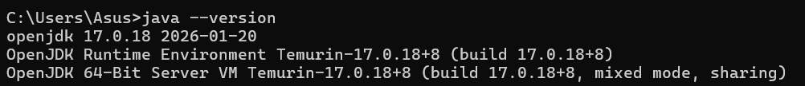
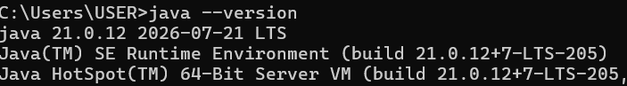
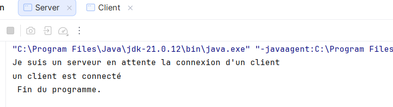
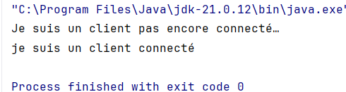
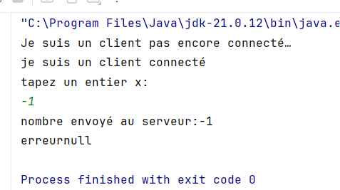
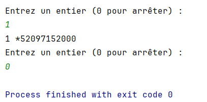

TP 1 : Les sockets en mode connecté TCP
Activité 1-1 : Première connexion Client/Serveur
Objectifs
● Apprendre à établir une communication Client/Serveur (C/S) en Java à l’aide des
sockets en mode connecté TCP.
Environnements
● JDK >=1.8
● Eclipse IDE for Java developers Ou IntelliJ IDAE > 1.8 OU VS code
● Git
Type de l’activité
● Individuel
Ressources
● Consultez séance 1 du cours “Développement d’applications réparties”
● Guide pratique : Intégration de Git avec Eclipse et IntelliJ
Livrables
● Repository git qui porte le nom “TP1-DAR2026”
● Le lien du repository dans l’espace de dépôt de la plateforme ENT
● Le fichier READ ME mis à jour
Enoncé
Dans cette activité, vous êtes demandés à développer une connexion entre un client et un serveur
en utilisant des sockets en mode connecté.
Vous devez créer deux applications distinctes :
● une première application permettant de lancer le serveur,
● une deuxième application permettant de lancer le client.
Travail demandé
Cette activité comporte cinq étapes :
Page 2 sur 4
Étape 1 : Préparation de l’environnement Git
1. Vérifiez l’installation de Git sur votre système en tapant :
   git --version
   
Étape 2 : Préparation de l’environnement Java
2. Vérifiez la version de Java installée sur votre système 

Étape 3 : Création du serveur

3. Étape 4 : Création du client

Activité 1-2 : Service de calculatrice
Étape 2 : Création du service de multiplication
1. Étendez les deux applications (Client et Serveur), développées dans l’Activité 1-1, pour
   implémenter les traitements suivants :
   a) Le Client est demandé de taper un entier x au clavier.
   b) Le client envoie cet entier au serveur.
   c) Le serveur, qui était en attente de ce nombre, le reçoit.
   d) Le serveur calcule par exemple le produit x*5.
   e) Le serveur envoie le résultat au client.
   f) Le client reçoit le résultat.
2. Lancez d’abord l’application Serveur, puis l’application Client.
3. Testez le programme avec différentes valeurs de x (positives, négatives, zéro) et
   interprétez les résultats affichés

4. 5. Modifiez l’application de manière que :
      a) Le client puisse saisir plusieurs entiers successivement.
      b) Après chaque saisie, le client envoie l’entier au serveur, reçoit le résultat du
      calcul (x * 5), puis l’affiche.
      c) Le processus continue tant que l’utilisateur saisit un entier différent de 0.
      d) Lorsque l’utilisateur saisit 0, la communication entre le client et le serveur
      s’arrête proprement, et les sockets sont fermés des deux côtés.

Activité 1-3 : Amélioration sur le service de calculatrice

